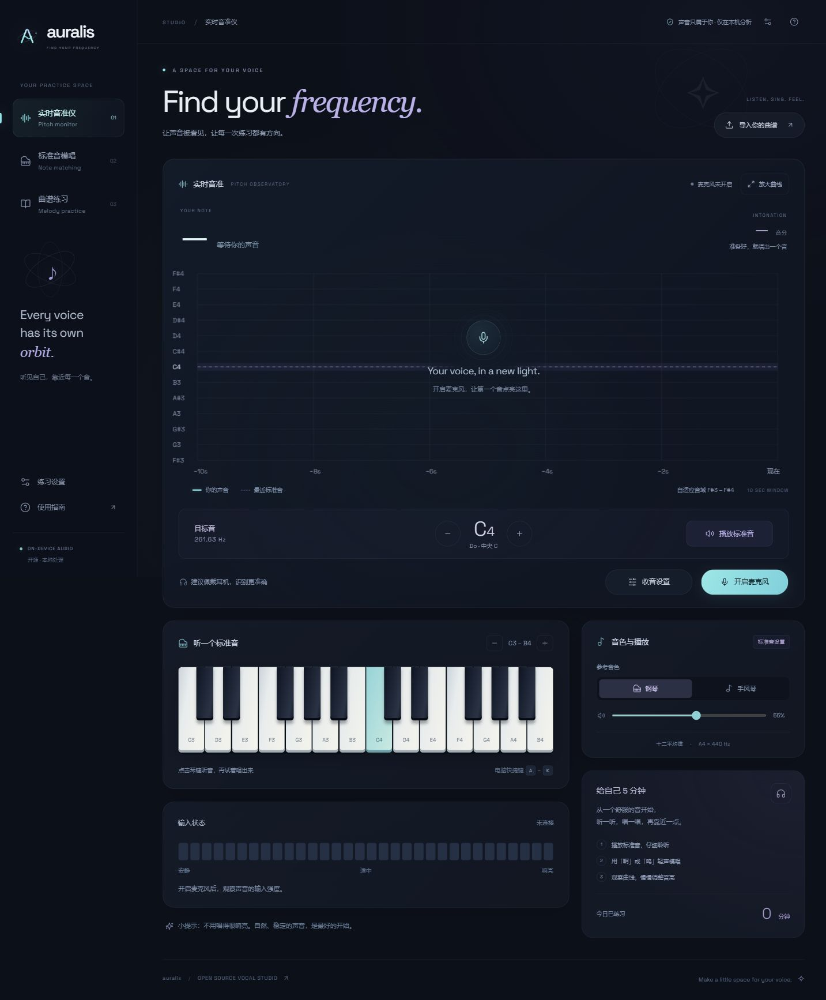

# Auralis · Vocal Practice Studio

一个开源的浏览器人声练习室：听标准音、看自己的音高曲线，再按旋律练习音准与节奏。英文视觉标题搭配中文操作，方便理解音分、曲谱与练习反馈。前端使用 TypeScript、Vite 和 Web Audio；日常练习无需账号或应用服务器。

**在线使用：[打开 Auralis · Vercel](https://singing-key-practice.vercel.app/)**

备用入口：[GitHub Pages](https://ruoyu-tianyi.github.io/singing-key-practice/)。两个域名的浏览器本地数据独立，曲谱可通过 JSON 导出、导入迁移。

源码：[Ruoyu-Tianyi/singing-key-practice](https://github.com/Ruoyu-Tianyi/singing-key-practice)。公开仓库，原创代码使用 MIT 许可。



[查看手机布局](docs/preview-mobile.jpg) · [查看收音设置](docs/preview-settings.jpg)。深夜蓝背景搭配冰青、柔紫的音高轨迹，原生 SVG 标志融合字母 A、人声音高曲线和轨道；英文采用自托管的 Space Grotesk 字体。名称与资产说明见 [品牌设计](docs/BRAND.md)。

## 可以做什么

- **实时音准仪**：全宽的大幅音高曲线，支持进一步放大；纵轴根据最近 10 秒整段声音自动调整，跨八度的历史曲线完整保留，稳定后再缩小音域。显示音名、频率、音分偏差和输入强度；±25 音分以内显示为唱准。
- **标准音模唱**：点击两组八度琴键或调整目标音，通过扬声器/耳机听音，再模唱。提供钢琴风格与手风琴风格的本地合成音色；默认 A4 = 440 Hz，可调整为 430–450 Hz。
- **曲谱练习**：内置《小星星》《欢乐颂》和 C 大调音阶；支持示范、4 拍预备、节拍器、30–220 BPM、选择音符片段、±12 半音移调与循环练习。
- **导入与编谱**：导入 MusicXML、MXL、MIDI 和本项目 JSON；手动输入简谱；图片/PDF 简谱可在浏览器生成 OCR 文字草稿。所有模板均可逐音校对音高与拍数，五线谱扫描件可选接入 Audiveris 服务。
- **练习反馈**：显示音准命中率、有效发声覆盖率与换音平均时间偏差。自定义曲谱、练习设置和当天时长保存在当前浏览器，可导出曲谱 JSON。
- **收音设置**：提供轻声、日常和较吵环境预设，可调整分析增益、音量门限、识别音域、可信度、检测更新频率与分析窗口；保存后用于当前监听，并保存在本浏览器。
- **多端界面**：按桌面、平板和手机屏幕调整布局，提供适合触控的操作区域，尊重系统减少动态效果设置。手机宽度下目标音、播放及曲谱开始操作紧接曲线，放大曲线时一起显示。麦克风与播放需要浏览器授权及用户点击。

钢琴、手风琴均为合成音色，没有使用真实乐器录音采样。检测适用于独唱的单旋律；伴奏、多人声音、噪声和扬声器回传会影响结果。建议佩戴耳机，或先听示范再唱。

## 本地运行

需要 **Node.js 22 或更新版本**、**pnpm 11.25.0**。在项目目录依次运行：

```shell
pnpm install
pnpm dev
```

在本机浏览器打开开发服务器显示的地址，默认是 `http://localhost:5173`。点击“开启麦克风”并允许访问，再自然地唱一个持续音。

```shell
pnpm test
pnpm build
pnpm preview
```

`pnpm test` 运行前端自动化测试；`pnpm build` 执行类型检查并生成 `dist/`；`pnpm preview` 预览构建结果。可选 Python 服务的测试命令为：

```shell
python -m unittest discover -s server -p "test_*.py"
```

当前验证范围和设备实测状态见 [验证记录](docs/VERIFICATION.md)。

本次界面改版保留既有曲谱、设置和练习统计的浏览器存储键；继续使用原域名即可读取原有数据。实时读数仅在数值变化时更新对应页面节点，减少重复改写。

## 怎样练习

1. 在“实时音准仪”中开启麦克风，观察音高与输入强度。
2. 在“标准音模唱”中选一个舒服的音，点击播放，听完后用“啊”或“呜”模唱。此模式的偏差以所选目标音为准；实时音准仪则对准最近的标准音。
3. 在“曲谱练习”中选择曲目或导入文件，先听示范，再降低速度、选择片段开始练习。

练习默认不播放旋律提示音，以减少扬声器串音；可按需要启用。切到后台时会停止播放与麦克风监听。

**如何理解反馈**：音准命中率只计算检测到有效音高的时段，应与覆盖率一起看；未检测到人声不会给出音准分数。节奏反馈根据发声/换音时间估算，连续同音难以分辨；设置中的 0–500 ms 延迟校正用于时间偏差参考。它们是练习反馈，没有经过专业考试评分标定。

## 调整收音

点击曲线下方的“收音设置”，先选择适合环境的预设，再按需要微调。弹窗仅滚动中间的设置内容，标题和底部“保存设置 / 恢复收音默认值”操作始终可见。修改、预设和“恢复收音默认值”都只改变当前表单；点击“保存设置”才会应用并保存，关闭弹窗可放弃未保存的改动。标准音 A4 与跟唱延迟同样在保存后生效，未保存的输入不会影响检测或评分。已开启的监听无需重新授权即可应用设置；旧版应用保存的设置可继续读取。

| 选项 | 默认值 | 可选范围与效果 |
| --- | --- | --- |
| 收音灵敏度 · 输入增益 | 1.0× | 0.5–4.0×；放大供分析的数字信号，也会放大背景声。不改变系统麦克风音量，不从扬声器播放人声。 |
| 音量门限 | 0.008 | 0.001–0.050；调低更容易拾取轻声和尾音，也更容易收进环境声；调高会忽略较轻的声音，轻声曲线可能中断。 |
| 最低音高 | 50 Hz | 40–500 Hz；低于下限的音高估计不显示。 |
| 最高音高 | 2200 Hz | 200–3000 Hz；高于上限的音高估计不显示。最低音高必须小于最高音高。 |
| 识别可信度门限 | 87% | 60–99%；调高会更严格地过滤估计，曲线可能变少；调低更容易显示不稳定的音高。此比例是算法指标，不是唱准分数。 |
| 检测更新频率 | 30 次/秒 | 10、20、30、60 次/秒；较高可显示更密的变化，也增加计算与耗电。实际次数受设备性能和浏览器回调限制。 |
| 分析窗口 | 4096 个采样 | 2048、4096、8192 个采样；长窗口包含更长的声音片段，可覆盖低音的更多周期，但响应变化可能更慢、计算更多；短窗口的低音识别可能较难稳定。 |

轻声、日常、较吵环境预设分别使用 **2× / 0.004 / 87%**、**1× / 0.008 / 87%**、**1× / 0.020 / 93%** 的增益、音量门限与可信度组合。音域可选择宽音域 **50–2200 Hz**、偏低 **65–1000 Hz**、偏高 **130–2000 Hz**，或自定义上下限。音域过滤不会把声音移调到范围内，也不能代替降噪；任何预设都不能保证复杂环境中的准确率。

这里有三种不同的“频率”：**音高 Hz** 表示声音高低，例如 A4 = 440 Hz；**检测更新次数/秒** 表示多久分析一次；只读的**音频处理采样率**表示浏览器每秒处理多少声音采样，由浏览器与设备决定。改变检测更新次数不会改变采样率或音高。分析窗口时长为采样数除以采样率：4096 个采样在 48,000 Hz 下约为 85.3 ms，这是音频片段跨度，不是端到端延迟保证。改变窗口后，可能需要重新调整跟唱延迟校正。[MDN：音频处理采样率](https://developer.mozilla.org/en-US/docs/Web/API/BaseAudioContext/sampleRate)、[浏览器动画回调](https://developer.mozilla.org/en-US/docs/Web/API/Window/requestAnimationFrame)、[分析窗口](https://developer.mozilla.org/en-US/docs/Web/API/AnalyserNode/fftSize)

音量门限使用数字信号电平，不是实际声压；可信度来自 Pitchy 的音高估计。收音设置只影响本机分析，不录音、不上传，也不会监听回放麦克风声音。[MDN：时域采样](https://developer.mozilla.org/en-US/docs/Web/API/AnalyserNode/getFloatTimeDomainData)、[Pitchy 官方说明](https://github.com/ianprime0509/pitchy)

## 导入曲谱

| 文件/来源 | 当前行为 |
| --- | --- |
| MusicXML / MXL | 读取首个含音高的 part，再取其首个旋律 voice / staff；处理音高、休止、时值、延音线和移调。 |
| MIDI | 读取首个非打击乐、有音符的轨道；同起点和弦优先取高音，重叠音简化为单旋律。 |
| JSON | 导入本工具导出的练习模板。适合在不同设备间手动传递曲谱。 |
| 图片 / PDF 简谱 | Tesseract.js 本地文字识别；PDF 最多 10 页。先对照原谱修正文字，再确认导入。 |
| 图片 / PDF 五线谱 | 启动 [Audiveris 本地识别服务](server/README.md)后导入。当前工作区已准备便携环境并通过真实谱面验证；新克隆需要先安装/准备引擎。 |

文件最大 20 MB，模板最多 10,000 个音符。反复记号按谱面顺序读一遍，整首使用统一速度；不会自动展开反复、还原完整乐队总谱或判断哪条声部是主唱。来源说明会提示简化。复杂曲谱优先从制谱软件导出 MusicXML，导入后仍应试听核对。

简谱 OCR 不可靠保留上下八度点、减时线和附点，歌词或页码也可能干扰识别；它不能代替五线谱 OMR。手动简谱以中央 C 为 `1`，支持以下写法：

```text
1=C 4/4
BPM: 80
1 2 3 4 | 5 6 7 1' | 1' 7 6 5 | 4 3 2 1-
```

`0` 休止，`1'` 高八度，`1,` 低八度，`1_` 半拍，`1__` 四分之一拍，`1-` 两拍，`1.` 一拍半，`#1` / `b3` 为升降音。可写 `1=D` 指定调号；音符之间用空格分隔，拍数始终以四分音符为单位。

## 手机、平板与 HTTPS

宽度不超过 760px 时，页面收起装饰性标题区，将目标音的升降、频率与播放放在曲线下方；曲谱模式也将曲目、速度、听示范和开始练习放在同一区域。放大曲线时这些操作随曲线进入放大视图，便于触屏练习。

电脑可用本机 `localhost`；手机/平板访问电脑的局域网 HTTP 地址时，浏览器通常不会提供麦克风。多端使用应把 `dist/` 部署到 HTTPS 静态站点，再在各设备访问同一地址。[浏览器麦克风安全上下文要求](https://developer.mozilla.org/en-US/docs/Web/API/MediaDevices/getUserMedia)

GitHub Pages 可托管前端：在仓库的 **Settings → Pages** 选择 **GitHub Actions**，由构建流程安装依赖、运行 `pnpm build`，将 `dist/` 作为 Pages 构建产物发布。项目使用相对资源路径，可部署在仓库子路径；上线状态与最终地址应以成功的 Pages 部署结果为准。[GitHub 官方部署说明](https://docs.github.com/en/pages/getting-started-with-github-pages/using-custom-workflows-with-github-pages)

**Vercel 同样可托管前端**：直接导入本仓库，选择 Vite、Node.js 22.x 和 `main` 生产分支；仓库已提供安装、构建与输出目录配置。部署成功后，手机和平板通过生产 HTTPS 地址访问并授权麦克风即可练习。具体设置、跨域名数据迁移及识别服务边界见 [Vercel 部署说明](docs/VERCEL.md)。

本地 Audiveris 服务默认只接受电脑自身的请求。手机上的 `127.0.0.1` 指向手机，无法直接使用电脑的识别服务；可以先在电脑识别，导出 JSON 后转到手机。GitHub Pages 只托管前端，不运行 Python/Audiveris。

## 数据与边界

- 麦克风声音在设备内实时分析，不录制、不上传。近期音高曲线只存于页面内存。
- 普通曲谱导入与简谱 OCR 在本地处理；首次 OCR 会联网下载引擎/语言资源。选择五线谱服务后，曲谱文件才会发送到填写的地址。
- 浏览器存储没有账号、云备份或跨设备同步；清理网站数据会删除本地曲谱和统计。需要保留的曲谱请先导出。
- 当前有网页清单与图标，没有离线缓存服务；不保证离线重新打开，首次 OCR 也需要联网。
- 布局适配不等于所有设备音频功能均已实测；Safari、蓝牙耳机与不同麦克风的延迟需实际校准。

## 开源与贡献

原创代码使用 [MIT License](LICENSE)。可复用模块与同类应用调研见 [开源调研](docs/OPEN_SOURCE_RESEARCH.md)，依赖声明见 [THIRD_PARTY_NOTICES.md](THIRD_PARTY_NOTICES.md)。Audiveris 适用其自身 AGPL-3.0 许可，未包含在前端分发中。

欢迎提交兼容性问题、识别失败的最小曲谱样本和改进。涉及第三方歌曲或谱面时，请仅提交有权公开分享的内容；反馈问题时附浏览器/设备、文件格式与复现步骤即可。
